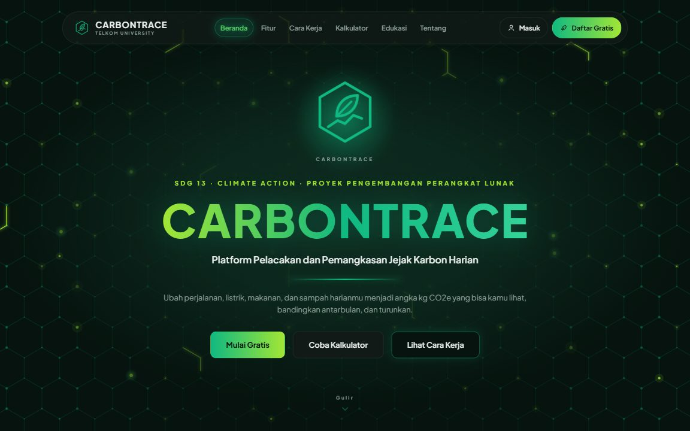
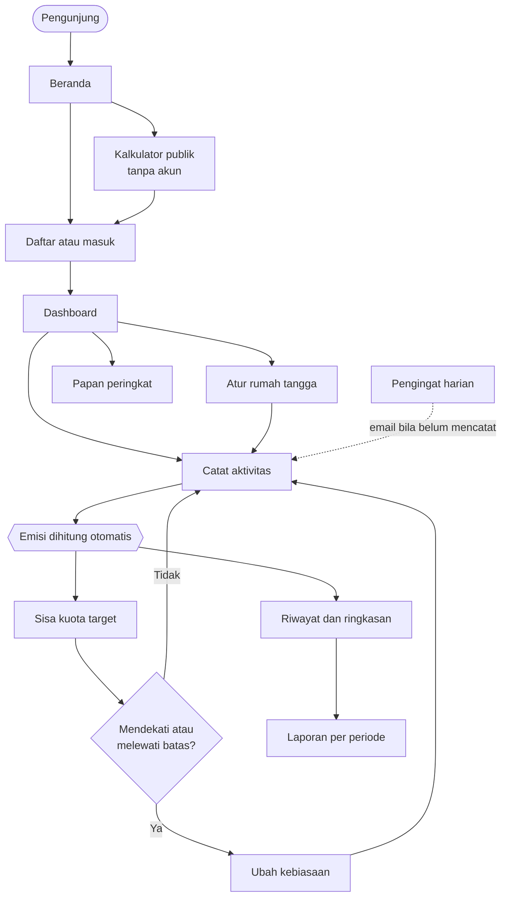
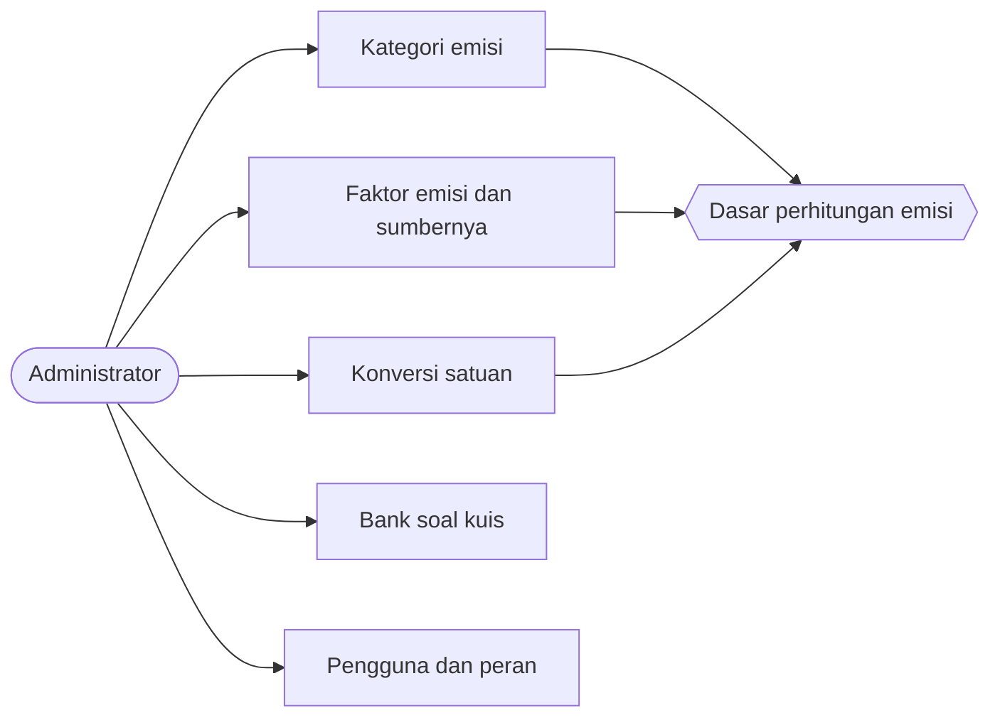
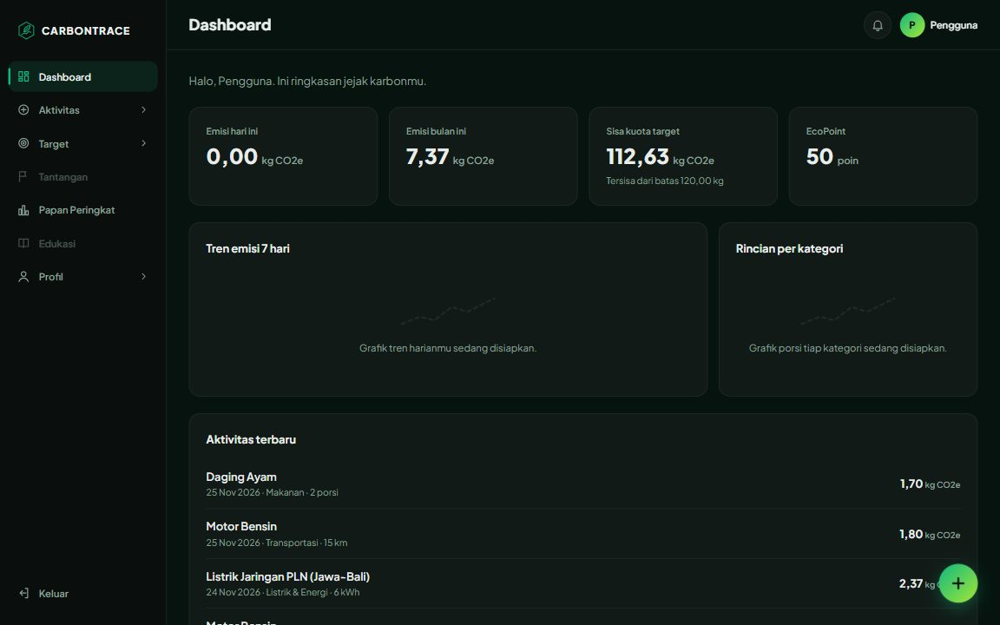
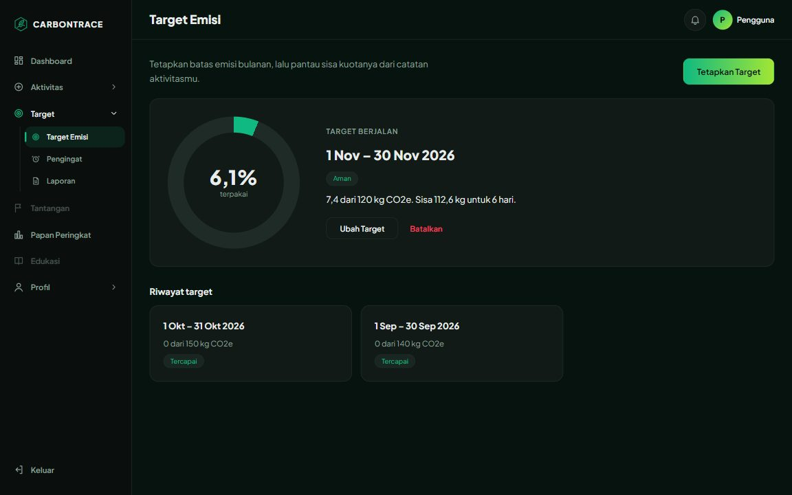
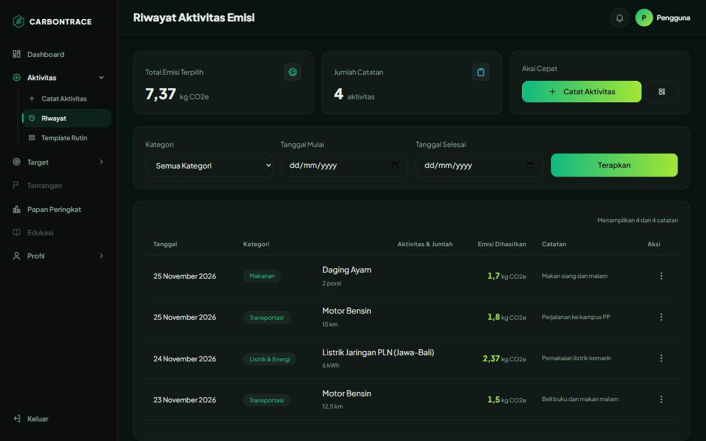
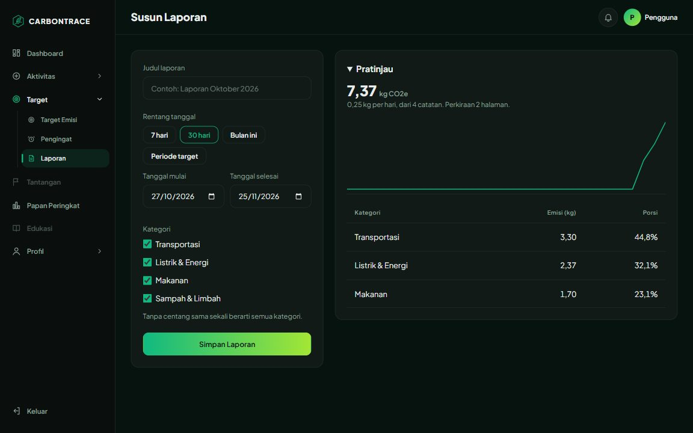

<h1 align="center">CarbonTrace</h1>

<p align="center">
  <strong>Platform Pelacakan dan Pemangkasan Jejak Karbon Harian</strong><br>
  Ubah perjalanan, listrik, makanan, dan sampah harian menjadi angka kg CO2e yang bisa dilihat, dibandingkan, dan diturunkan.
</p>

<p align="center">
  
  
  
  
  
</p>

<p align="center">
  <a href="#tentang">Tentang</a> ·
  <a href="#alur-penggunaan">Alur</a> ·
  <a href="#fitur">Fitur</a> ·
  <a href="#cara-emisi-dihitung">Perhitungan</a> ·
  <a href="#menjalankan-di-komputer-sendiri">Instalasi</a> ·
  <a href="#tim">Tim</a>
</p>



## Tentang

Banyak orang ingin mengurangi jejak karbonnya, tetapi tidak tahu dari mana asalnya. Kalkulator sekali pakai hanya memberi satu angka, tidak menyimpan riwayat, dan tidak bisa dibandingkan antarbulan.

CarbonTrace membantu pengguna mencatat aktivitas sehari-hari, menghitung emisinya secara otomatis, menetapkan batas bulanan, lalu melihat apakah kebiasaannya membaik. Proyek ini mendukung **SDG 13 (Penanganan Perubahan Iklim)** dan dibuat untuk mata kuliah Pengembangan Perangkat Lunak, Telkom University.

## Alur Penggunaan



1. **Coba dulu.** Pengunjung menghitung satu aktivitas lewat kalkulator publik tanpa membuat akun.
2. **Daftar dan atur.** Pengguna membuat akun, lalu mengisi jumlah penghuni rumah supaya emisi listrik dibagi dengan tepat.
3. **Catat.** Pilih kategori, isi jumlahnya, dan sistem menghitung emisinya. Aktivitas rutin bisa disimpan sebagai template.
4. **Pantau.** Dashboard menampilkan emisi hari ini, bulan ini, dan sisa kuota target.
5. **Tetapkan target.** Batas bulanan diberi status Aman, Hampir, atau Terlampaui.
6. **Evaluasi.** Susun laporan untuk rentang tanggal dan kategori pilihan.

### Alur administrator



## Tampilan

| Dashboard | Target emisi |
|---|---|
|  |  |
| **Riwayat aktivitas** | **Susun laporan** |
|  |  |

## Fitur

Keterangan: ✅ tersedia · 🟡 sebagian · ⬜ direncanakan

| Kelompok | Fitur | Status |
|---|---|:---:|
| **Publik** | Beranda dan kalkulator jejak karbon tanpa akun | ✅ |
| **Akun** | Daftar, masuk, keluar, dan lupa kata sandi | ✅ |
| | Profil pengguna dan pengaturan rumah tangga | ✅ |
| | Manajemen pengguna dan peran | ✅ |
| **Pencatatan** | Catat aktivitas harian dan riwayatnya | ✅ |
| | Template aktivitas rutin | ✅ |
| | Bank pertanyaan kuis | ✅ |
| | Pengisian kuis awal dan garis dasar emisi | ⬜ |
| **Data emisi** | Kategori, faktor emisi, dan konversi satuan | ✅ |
| **Target dan laporan** | Target emisi bulanan | ✅ |
| | Pengingat pencatatan harian lewat email | ✅ |
| | Laporan jejak karbon (unduhan PDF menyusul) | 🟡 |
| **Dashboard** | Ringkasan angka, aktivitas terbaru, dan pengumuman | ✅ |
| | Grafik tren dan rincian per kategori | ⬜ |
| **Gamifikasi** | Papan peringkat komunitas | ✅ |
| | Lencana, tantangan, dan keikutsertaan tantangan | ⬜ |
| **Edukasi** | Artikel edukasi | 🟡 |
| | Rekomendasi aksi, pengumuman, dan balasan artikel | ⬜ |
| | Statistik dampak komunitas | ⬜ |

## Cara Emisi Dihitung

```text
emisi (kg CO2e) = jumlah × faktor emisi
```

| Kategori | Perhitungan |
|---|---|
| Transportasi | jarak (km) × faktor |
| Listrik | pemakaian (kWh) × faktor ÷ jumlah penghuni rumah |
| Makanan | berat (kg) atau porsi yang dikonversi × faktor |
| Sampah | berat (kg) × faktor |

Contoh: 4 kWh × 0,681 kg CO2e/kWh = **2,72 kg CO2e**. Pembagian jumlah penghuni hanya berlaku bagi pengguna yang sudah mengisi pengaturan rumah tangga. Faktor emisi dikelola administrator beserta tautan sumbernya.

## Teknologi

| Bagian | Yang dipakai |
|---|---|
| Backend | Laravel 13, PHP 8.3 |
| Basis data | MySQL 8 |
| Frontend | Blade, Tailwind CSS 4, Vite 8, JavaScript tanpa kerangka kerja |
| Peran dan izin | spatie/laravel-permission |
| Pengujian | PHPUnit 12 |

## Menjalankan di Komputer Sendiri

**Kebutuhan:** PHP 8.3 atau lebih baru, Composer, Node.js 22, dan MySQL 8. Di Windows, [Laragon](https://laragon.org) sudah menyediakan PHP dan MySQL.

1. Unduh proyek dan pasang paketnya.

   ```bash
   git clone https://github.com/TUBES-PPL-KELOMPOK-B-C/CarbonTrace.git
   cd CarbonTrace
   composer install
   npm install
   ```

2. Siapkan konfigurasi.

   ```bash
   cp .env.example .env
   php artisan key:generate
   ```

3. Buat basis data `carbontrace` di MySQL, lalu sesuaikan bagian ini di `.env`.

   ```env
   APP_NAME=CarbonTrace
   DB_CONNECTION=mysql
   DB_HOST=127.0.0.1
   DB_PORT=3306
   DB_DATABASE=carbontrace
   DB_USERNAME=root
   DB_PASSWORD=
   ```

4. Buat tabel beserta data contoh, lalu jalankan.

   ```bash
   php artisan migrate --seed
   npm run build
   php artisan serve
   ```

Buka `http://127.0.0.1:8000`. Data contoh menyediakan dua akun berikut, **hanya untuk pengembangan**:

| Peran | Email | Kata sandi |
|---|---|---|
| Pengguna | `pengguna@carbontrace.id` | `Password123!` |
| Administrator | `admin@carbontrace.id` | `Admin123!` |

Pengingat harian dikirim oleh penjadwal, yang dijalankan terpisah:

```bash
php artisan schedule:work
```

Selama `MAIL_MAILER=log`, isi email dicatat di `storage/logs/laravel.log` dan tidak benar-benar dikirim.

### Menjalankan pengujian

```bash
php artisan test
```

## Contoh API

Semua jawaban berbentuk JSON. Selain kalkulator, daftar, dan masuk, pengguna harus sudah masuk. Kedua rute `pratinjau` juga memerlukan token CSRF, karena dipakai dari halaman aplikasi.

| Metode | Alamat | Kegunaan |
|---|---|---|
| `POST` | `/api/kalkulator` | Menghitung emisi tanpa akun |
| `POST` | `/api/daftar`, `/api/masuk`, `/api/keluar` | Autentikasi |
| `GET` | `/api/saya` | Data pengguna yang sedang masuk |
| `POST` | `/api/aktivitas/pratinjau` | Menghitung emisi sebelum dicatat |
| `GET` | `/api/target/berjalan` | Sisa kuota target berjalan |
| `POST` | `/api/laporan/pratinjau` | Angka laporan tanpa menyimpan |
| `GET` | `/api/papan-peringkat` | Data peringkat |

```bash
curl -X POST http://127.0.0.1:8000/api/kalkulator \
  -H "Content-Type: application/json" \
  -d '{"emission_factor_id": 1, "amount": 4}'
```

## Susunan Proyek

```text
app/
├── Console/Commands    perintah terjadwal, mis. pengiriman pengingat
├── Http/Controllers    pengendali tiap modul
├── Policies            hak akses per data
└── Services            perhitungan emisi, target, laporan, dan dashboard
database/               migrasi dan data contoh
resources/views/        tampilan Blade per modul
routes/                 satu berkas rute per modul
tests/                  pengujian fitur dan unit
Folder MD/              spesifikasi tiap anggota
```

Sebagian besar berkas berakhiran tiga angka yang menandai pembuatnya, misalnya `Target022.php`. Akhiran `111` dipakai untuk fitur pendukung. Nama tabel tidak memakai akhiran.

## Tim

| Nama | Peran | Modul |
|---|---|---|
| Alvin Hibatullah | Ketua, Scrum Master, Developer | Target, Pengingat, dan Laporan |
| Hadi Dwi Pranoto | Product Owner, Front-End Lead, Developer | Pencatatan Aktivitas |
| Renaya Marvela Adoe | Quality Assurance, Developer | Data Master Emisi |
| Rosi Rahmawati | Developer | Akun dan Administrasi |
| Man Rezki Setiawan | Developer | Gamifikasi |
| Tio Maria Anggita Sinaga | Developer | Edukasi dan Komunitas |

## Berkontribusi

1. Buat branch dari `main` terbaru.
2. Sertakan kunci Jira di pesan commit, misalnya `SCRUM-19 Unduh PDF laporan`.
3. Pastikan `php artisan test` lolos.
4. Ajukan pull request ke `main` dan minta minimal satu anggota meninjaunya.

---

<p align="center">Proyek Pengembangan Perangkat Lunak, Telkom University, 2026</p>
